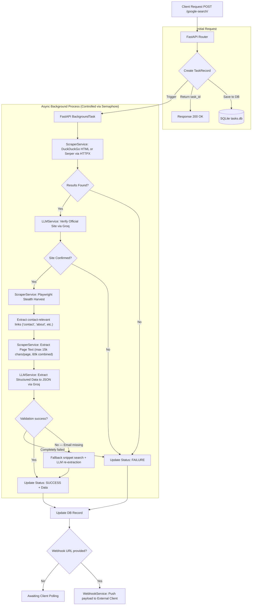
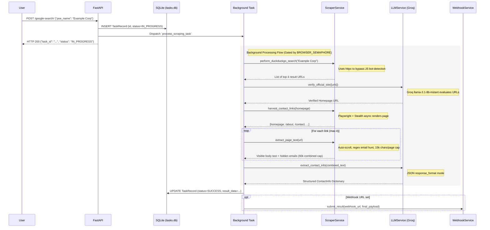

# Scraper Service Architecture

This document describes the architectural flow, component relationships, concurrency controls, and reliability mechanisms of the asynchronous, FastAPI-based scraping and intelligence application.

## Core Technologies

- **API Framework**: FastAPI 0.129.0
- **Database**: SQLite (managed via SQLModel, WAL journal mode + 30 s `busy_timeout`)
- **Scraping Engine**: HTTPX (initial search) & Playwright Async + Stealth (deep page interaction)
- **AI Extraction (Scraper pipeline)**: Groq API (`llama-3.1-8b-instant`)
- **AI Search (OpenAI pipeline)**: OpenAI Responses API with `web_search` tool (`gpt-4o-mini`)
- **AI Search (Gemini pipeline)**: Google Gemini with live Google Search grounding (`gemini-2.5-flash-lite`)
- **Employment Verification (VOE) & Discovery (POE)**: Gemini and OpenAI multi-turn grounded research
- **Company Identity Matching**: Groq / OpenAI / Gemini entity resolution with optional deep search
- **PDF Processing**: Gemini Files API or OpenAI vision (`pypdfium2` page rendering)
- **Logging**: Loguru (file: `scraper.log`, rotation 100 MB, retention 30 days)

---

## 1. High-Level Flow Diagram

The following flowchart illustrates the entire lifecycle of an asynchronous scraping request, from incoming API call to the final webhook delivery and database persistence.



---

## 2. Sequence Diagram: Core Scraper Pipeline

This sequence diagram details the interaction between the core internal services during a `/google-search/` execution.



---

## 3. Comprehensive Pipeline Catalog

The service exposes 9 dedicated intelligence pipelines:

| Endpoint | Provider | Execution | Primary Output |
|---|---|---|---|
| `POST /google-search/` | DuckDuckGo/Serper + Playwright + Groq | Async (Background) | Crawled & extracted company contact info |
| `POST /openai-search/` | OpenAI (`gpt-4o-mini`) | Async (Background) | 3-turn grounded contacts with departmental tags |
| `POST /gemini-search/` | Gemini (`gemini-2.5-flash-lite`) | Async (Background) | 3 parallel sub-gatherers with Google Search grounding |
| `POST /combined-search/` | OpenAI + Gemini (concurrent) | Async (Background) | Merged, deduplicated contacts + summary counts |
| `POST /verify-voe/` | Gemini, OpenAI, or both | Async (Background) | Employment verification verdict + confidence score (0–10) |
| `POST /find-poe/` | Gemini, OpenAI, or both | Async (Background) | Ranked employer candidates list for an individual |
| `POST /match-companies/` | Groq, OpenAI, or Gemini | Synchronous | Company entity resolution verdict & confidence |
| `POST /extract-pdf/` | Gemini Files API or OpenAI vision | Synchronous | Full OCR text with checkbox states (`[SELECTED]`) |
| `POST /parse-background-check/` | Gemini Files API or OpenAI vision | Synchronous | 7 structured fields from background screening reports |

All async pipelines return a `task_id` for polling via `GET /{pipeline}/{task_id}` and failed task inspection via `GET /{pipeline}/failed/`. PDF endpoints and the company matcher are synchronous.

---

## 4. Package Structure

```
app/
├── api/
│   ├── deps.py             — SQLite engine (WAL mode), get_session() dependency
│   ├── rate_limit.py       — In-process sliding-window rate limiter (15 req/60 s per IP)
│   └── routes.py           — All endpoint definitions and background task coroutines
├── core/
│   └── config.py           — Pydantic BaseSettings (env-file backed configuration)
├── models/
│   ├── __init__.py         — Models package exports
│   └── models.py           — Pydantic schemas (Request/Response) + SQLModel TaskRecord
└── services/
    ├── __init__.py         — Service package exports
    ├── _retry.py           — Dual-layer tenacity retry factories (Gemini, OpenAI, Groq)
    ├── _token_utils.py     — Token normalization helpers across LLM providers
    ├── scraper.py          — Playwright browser lifecycle + HTTPX search methods
    ├── llm.py              — Groq inference (site verification + contact extraction)
    ├── openai_search.py    — OpenAI 3-turn search pipeline
    ├── gemini_search.py    — Gemini 3-sub-gatherer search pipeline
    ├── combined_search.py  — Concurrent OpenAI + Gemini merge, deduplication, URL hygiene
    ├── voe_verification.py — Gemini employment verification
    ├── openai_voe.py       — OpenAI employment verification
    ├── gemini_find_poe.py  — Gemini employer discovery pipeline
    ├── openai_find_poe.py  — OpenAI employer discovery pipeline
    ├── company_matcher.py  — Entity resolution service (standard + deep search)
    ├── pdf_extractor.py    — PDF text extraction (Gemini Files API / OpenAI vision)
    ├── bg_check_parser.py  — Background check two-stage parsing pipeline
    └── webhook.py          — HTTP webhook push service
main.py                     — Uvicorn entry point, lifespan DB init, Loguru logging setup
```

---

## 5. Concurrency, Reliability & Resilience

### Browser Semaphore Gate
A global `asyncio.Semaphore(MAX_CONCURRENT_BROWSERS)` gates all Playwright tasks. Even under heavy concurrent request spikes, only `MAX_CONCURRENT_BROWSERS` (default 4, configurable via `.env`) active Chromium instances run at once. Extra tasks queue safely in the asyncio event loop.

### In-Process Sliding-Window Rate Limiter
A per-IP sliding-window rate limiter (`app/api/rate_limit.py`) caps task-creation endpoints at **15 requests per 60 seconds**.
- Applied per-route via `Depends(task_rate_limit)`.
- Respects `X-Forwarded-For` reverse-proxy headers (takes the leftmost address).
- Throttled requests immediately receive **HTTP 429 Too Many Requests** with `Retry-After: <seconds>` headers.

### Dual-Layer Retry Architecture
All network calls to AI providers utilize a nested retry structure:

```
Layer 1 — SDK-Native (Inner):
    • OpenAI / Groq: max_retries=2 (respects HTTP Retry-After headers on 429/5xx)
    • Gemini: types.HttpRetryOptions(attempts=2)
Layer 2 — Tenacity (Outer):
    • 3 attempts, exponential backoff with full jitter (3 s to 60 s)
    • Catches DeadlineExceeded, socket drops, and errors exhausted by Layer 1
Total Call Ceiling:
    3 (tenacity) × 3 (1 initial + 2 SDK retries) = 9 maximum API calls per request
```

### SQLite Concurrency (WAL Mode)
SQLite is configured with production-grade pragmas on every connection:
- `PRAGMA journal_mode=WAL;` — Readers do not block writers, writers do not block readers.
- `PRAGMA busy_timeout=30000;` — Waits up to 30 seconds for lock release before raising `OperationalError`.
- `PRAGMA synchronous=NORMAL;` — Optimal balance between disk I/O performance and crash durability.
- Connection Pool: `pool_size=5`, `max_overflow=10`, `pool_recycle=1800` (recycles connections every 30 minutes), and `check_same_thread=False`.

### Anti-Hallucination Triple-Pass Verification
For grounded search endpoints (`/openai-search/` and `/gemini-search/`):
1. **Gatherer**: Researches the live web and generates cited Markdown notes.
2. **Extractor**: Converts cited findings into typed Pydantic models.
3. **Verifier**: A dedicated LLM fact-checking pass cross-examines every extracted contact against the raw citations. Phone/fax numbers are normalized using digit-only comparison to prevent false positives from formatting differences.

### Token Accounting
A normalized `TokenUsage` object is calculated across pipelines:
- Captures input tokens, output tokens, and total tokens.
- Normalizes disparate SDK naming conventions (e.g., Gemini's `prompt_token_count` vs. OpenAI's `input_tokens`).
- Combined endpoints report both provider-specific metrics and a consolidated `grand_total`.
